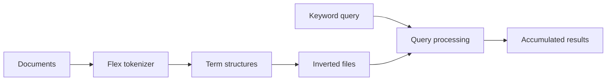

<p align="center"></p>

[Regan Yates](https://github.com/rjyates) · [Homelab](https://github.com/rjyates/homelab)


# Document search in C++

An educational information-retrieval project that tokenizes documents, writes an inverted index, and processes keyword queries. The repository illustrates the mechanics behind search: document/term structures, posting records, query tokenization, and result accumulation.

**Status:** legacy coursework snapshot. Historical scripts and assumptions are retained; this is not a production search service.

## What is here

| Component | Purpose |
| :--- | :--- |
| [multiple.lex](multiple.lex), [hw3.sh](hw3.sh) | Document scanning and memory-based index build |
| [documentHt.cpp](documentHt.cpp), [globalHt.cpp](globalHt.cpp), [List.cpp](List.cpp) | Document/global term structures |
| [invertedFile.cpp](invertedFile.cpp) | Dictionary, postings, document mapping, and configuration records |
| [query.lex](query.lex), [query.sh](query.sh) | Query tokenization and index lookup |
| [accumulator.cpp](accumulator.cpp), [queryList.cpp](queryList.cpp) | Query/result accumulation |
| [retrieve.lex](retrieve.lex), [webPage.php](webPage.php) | Historical retrieval/web-facing pieces |



## Historical setup

The scripts assume a Unix-like shell with **Flex, g++, and the Flex library (`libfl`)**. Run from the repository root and use a small disposable text corpus.

```bash
bash hw3.sh path/to/documents tinyout
bash query.sh search terms tinyout
```

These are the historical workflow commands, not a newly verified turnkey setup. `query.lex` still hardcodes `tinyout` in its lookup path, and `config.txt` is working-directory dependent. Full index/query execution needs validation in a compatible Flex environment.

## Screenshots from the original project


## Context and attribution

The original scripts identify Regan Yates's individual coursework and starter code from **Dr. Susan Gauch**. Source headers preserve that attribution. The repository should not be interpreted as an implementation written wholly without instructional scaffolding.

## Limitations and next steps

- Fixed record sizes and hardcoded paths reflect the original exercise.
- The PHP wrapper and historical scripts need separate review before serving requests.
- No modern ranking benchmark, semantic search, scale testing, or deployed service is claimed.
- A portable build, small fixture corpus, configurable paths, and repeatable query checks would be useful modernization work.

Documentation and source review: October 22, 2026. The six C++ implementation files passed a `g++ -fsyntax-only` check. Flex generation and full index/query execution were not tested in this environment.
